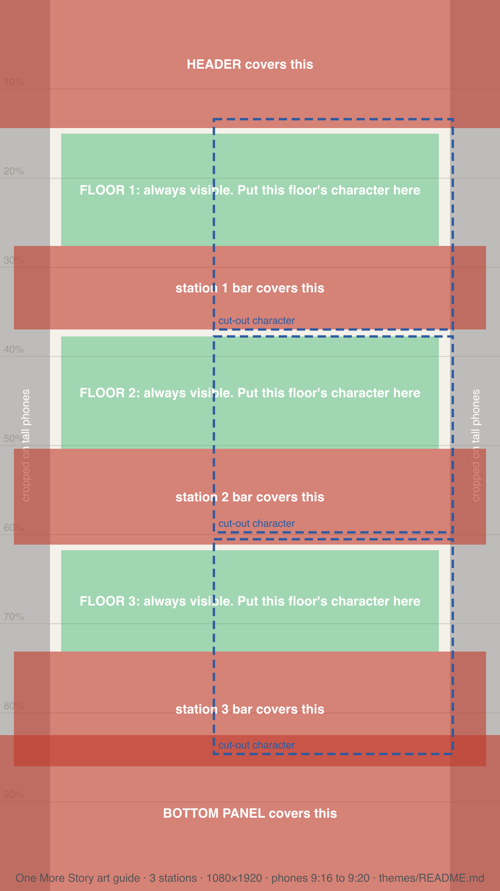

# Theme packs

A theme is a folder, `themes/<id>/`, that the game loads at run time. The rules come from
`gameplay.json` and everything the player sees and hears comes from `theme.json`. The screen
layout is the game's, not the pack's, so every theme has the same layout.

Every rule below is checked by `make theme-check`, which also runs in CI. The tests break a copy of
a real pack for each rule and check the problem is reported. **Error** stops the pack loading;
**Warning** loads it and says what to fix.

## Files

| File | Required | What it is |
|---|---|---|
| `theme.json` | yes | words, colours, pictures, voices ([schema](theme.schema.json)) |
| `gameplay.json` | yes | stations, prices, tools, payout rule ([schema](gameplay.schema.json)) |
| `LICENSE` | yes | who owns the pack and how it may be used |
| `CREDITS.md` | for art | who made each picture and sound |
| `art/*.png` | | pictures: PNG masters (WebP also loads; release builds ship WebP copies, see docs/RELEASE.md) |
| `audio/*.wav` | | voices |

A pack is listed in [`index.json`](index.json): under `themes` if store builds ship it, or under
`drafts` if only test builds offer it. A pack folder the index doesn't list is an error.

## The screen

```
┌──────────────────────────────┐  header: title (one line), coins, Theme, About
│ TITLE            ♥ 220  ⚙ ⓘ │  ← 92 points high, fixed: the top 12–14% of the picture
├──────────────────────────────┤
│        station 1 band        │  one equal band per station
│   [character, 172pt square]  │  ← actor stands here, right side
│ ▭▭▭▭▭▭ bar, 60pt ▭▭▭▭▭▭▭▭▭▭ │  ← every bar is 60 points high in every theme
├──────────────────────────────┤
│        station 2 band        │
│ ▭▭▭▭▭▭▭▭▭▭▭▭▭▭▭▭▭▭▭▭▭▭▭▭▭▭ │
├──────────────────────────────┤
│        station 3 band        │
│ ▭▭▭▭▭▭▭▭▭▭▭▭▭▭▭▭▭▭▭▭▭▭▭▭▭▭ │
├──────────────────────────────┤
│ dock: delivered, pause, hire │  ← bottom ~15% is covered
└──────────────────────────────┘
```

## The art guide



[`_shared/art-guide-3.png`](_shared/art-guide-3.png) shows where everything lands on a 1080×1920
background, for every phone from 9:16 to 9:20. **Red** is covered by the header, the station bars or
the bottom panel. **Grey** is cropped off the sides on tall phones. **Green** is the window on each
floor that every phone shows: that floor's character goes there. The **dashed blue** box is where a
cut-out character stands.

One picture serves every phone. It's scaled to fill the screen, never stretched: taller phones lose
a strip down each side, and the floors move a little because the header and bottom panel have a
fixed height. The guide already allows for both.

- Give an artist (or an image model) the guide with the brief.
- Check a picture before it goes in a pack: `make art-check ART=path/to/background.png` lays the
  guide over it and writes `build/art-check.png`. It needs ImageMagick (`magick`) and
  `rsvg-convert` (librsvg) as well as .NET; on a Mac: `brew install imagemagick librsvg`.
- The boxes come from `src/ProseForge.Game/Themes/ScreenLayout.cs`. A test pins it to a phone
  measured from its accessibility tree, and `make theme-guide` redraws the guide. If the screen
  layout changes, re-measure the phone and update the test, the model and the guide together.

## Pictures

| Picture | Rule | Level |
|---|---|---|
| any | PNG or WebP | error |
| `background` | portrait, aspect between 9:16 and 2:3 | error |
| `background` | at least 1024 wide; 1080×1920 is ideal | warning |
| `background` | a calm scene **without** the station characters in it; anything that must be seen goes in the green windows of the art guide | guidance |
| station `actor` | transparent PNG, at least 512 on the short side; shown fitted in a 172-point square on the right of its band | warning |
| missing picture | the shared placeholder is shown | warning |

The Guild is the reference. Its hall is the background, and each worker is a separate cut-out
standing over their own bar. A background with the characters painted in can't line up with the
bars on every phone.

## Voices

A station's `voice` is a short greeting (`audio/*.wav`), played when someone is hired there and when
the worker is tapped. A pack with no voices is complete; a missing file just stays silent.

Each voiced station also says which voice recorded it and who its picture shows:

```json
"voice": "audio/keeper-welcome.wav", "voiceId": "bf_alice", "speaker": "woman"
```

`voiceId` is the text-to-speech voice (ours are Kokoro voices: `af_`/`bf_` are women's voices,
`am_`/`bm_` men's). `speaker` is `"woman"` or `"man"`, set by whoever made the actor picture.
`make theme-check` fails the pack if the two disagree, or if a voiced station leaves either out.
A voice whose id doesn't give its gender, such as a greeting you recorded yourself, also says whose
voice it is: `"voiceId": "my-recording", "voiceGender": "woman"`. We added it
after eleven greetings shipped in the wrong voice for their picture, because the voices were chosen
before the art existed. Credit the voice in `CREDITS.md` as well.

## Words and colours

| Field | Rule | Level |
|---|---|---|
| `title` | at most 18 characters, so it fits the header on one line | error |
| `palette.*` | `#RRGGBB` or `#AARRGGBB` | error |
| `license` | not empty | error |
| `id` | matches the folder name, and the gameplay id (the save slot is named after it) | error |
| stations | one look per gameplay station, in the same order | error |
| a station collected by hand | has `collectLabel` | error |
| a station that receives work by hand | has `sendLabel` | error |
| a station that needs a shared tool | has `toolLabel` (the "buy one more" button) | error |
| a sellable station | has `sellMessage` | warning |
| `goalHire` | one hint per station after the first | warning |

Templates fill `{n}`, `{price}`, `{total}`, `{cost}`, `{waiting}` (the queue in front of a station)
and `{tools}` (how many of its shared tool there are). An unknown `{placeholder}` stays visible on
screen, so a typo is easy to spot.

## Gameplay

| Rule | Level |
|---|---|
| at least one station; station and tool ids unique | error |
| the first station starts with someone working | error |
| pay-on-delivery (`FinalStageOnly`): every station starts with someone working, or a new game can never earn its first coin | error |
| `FinalStageOnly`: the last station has a price | error |
| `AnyStage`: something has a price | error |
| times, costs, caps and batch sizes are positive | error |
